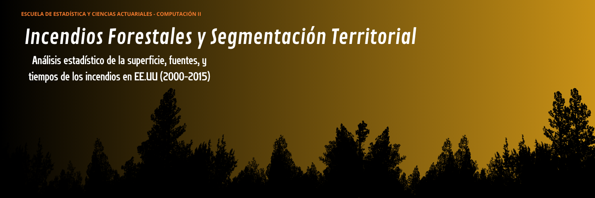

# GRUPO 11 

  

## Análisis y Visualización Interactiva de Incendios Forestales

# Incendios forestales y segmentació territorial(2000-2015): Análisis estadístico de la superficie, fuentes y tiempos de los incendios en EE.UU

El presente es un proyecto de procesamiento de datos masivos para el desarrollo de tableros interactivos y su documentacion teorica respectiva, a partir de la base de datos de incendios forestales de EE. UU. (<i>FPA FOD</i>).

## 📌 Descripción del Proyecto

Este repositorio es el resultado del trabajo realizado para completar el trabajo final de la materia <b>Computación II</b> de la Escuela de Estadistica y Ciencias Actuariales de la UCV.

 

El objetivo principal es construir un pipeline integral de datos que abarca desde la ingesta de datos brutos en formato SQLite, su transformación y optimización mediante <b>DuckDB</b> y <b>Python</b>, hasta el consumo en una aplicación interactiva en <b>Streamlit</b> y un panel de control corporativo en <b>Power BI</b>.

## Preguntas de investigación

1. ¿Cómo variaron la frecuencia, la severidad (superficie quemada) y las causas de los incendios forestales en Estados Unidos durante el período 2000–2015 al comparar las 10 regiones?
2. ¿Cómo varía la causa de origen de los incendios forestales según las regiones y cuáles son las principales fuentes de ignición que predominan en cada territorio?
3. ¿De qué manera se distribuyen los incendios de mayor severidad en el territorio nacional y qué región concentra la mayor proporción de estos eventos? 
4. ¿Existen diferencias significativas en el tiempo de contención y el tamaño final del incendio según la entidad administradora del terreno, Federal, Estatal o Privada dentro de cada región? 
5. ¿Cómo varían el tiempo de contención y la magnitud de los incendios forestales a lo largo de las cuatro estaciones del año en cada región? 

## Objetivo General

Analizar la relación de la ubicación geográfica y las características  de los incendios forestales en Estados Unidos durante el período 2000–2015.

## Objetivos específicos

1. Comparar la distribución y severidad de la superficie afectada por los incendios forestales entre las regiones, para identificar las zonas de mayor susceptibilidad y destrucción territorial.
2. Analizar la relación entre la causa de origen del incendio, humana o natural y la región de ocurrencia, para determinar los patrones de las fuentes de ignición  predominantes en cada territorio.
3. Identificar la proporción y magnitud de los incendios de alta severidad por región, para identificar los territorios con mayor concentración de mega-incendios a nivel nacional.
4. Comparar el tiempo promedio de contención y la superficie afectada de los incendios entre terrenos bajo administración federal  y terrenos estatales o privados en cada región, para identificar diferencias en la severidad e impacto según el tipo de propiedad del suelo. 
5. Evaluar la variación del tiempo de contención y la superficie quemada a través de las estaciones del año en cada región, para caracterizar el comportamiento de la respuesta operativa y la severidad.

## 📊 Fuente de Datos

El dataset original utilizado corresponde a la base de datos de incendios forestales de EE. UU. (<b>FPA FOD</b>), la cual contiene aproximadamente 1.88 millones de registros que van desde 1992 hasta 2015.

 

Debido a restricciones de tamaño de archivos en GitHub (el archivo SQLite original pesa mas de 750 MB), la base de datos completa no se incluye directamente en este repositorio. Puede ser descargada desde Kaggle en el siguiente enlace:

 
<ul>
  <li><b>Dataset original en Kaggle:</b> <a href="https://www.kaggle.com/datasets/rtatman/188-million-us-wildfires">1.88 Million US Wildfires</a></li>
</ul>

 

Adicionalmente, para la limpieza de los datos y de registros nulos, se uso el archivo shapefile de los condados de EEUU para el año 2025. El mismo fue obtenido a traves de la pagina del Censo de EEUU.

 
<ul>
  <li><b>Archivo Shapefile de los Condados: </b> <a href= "https://www.census.gov/geographies/mapping-files/time-series/geo/cartographic-boundary.2025.html"> Cartographic Boundary Files</a></li>
</ul>

 

Para facilitar la ejecución rápida del proyecto, se incluyo en el repositorio la versión en formato .parquet de la tabla Fire, (dentro de la carpeta data/), la cual fue generada mediante DuckDB omitiendo la geometría pesada (Shape). Dicha tabla representa la base para el desarrollo del resto del trabajo.

## 🛠️ Tecnologías Utilizadas

- Lenguaje: Python 3.14+
- Motor SQL / Analítico: DuckDB
- Formatos de Almacenamiento: SQLite, .duckdb, Parquet
- Visualización Web: Streamlit
- Business Intelligence: Power BI
- Control de Versiones: Git / GitHub

## 👥 Autores
Grupo 11 Computacion II

- Fabiola Bocaney
- Victoria Gilson
- Diego Guerrero
- Carlos Herrera
- Mariangel Morales
- Valeria Ruza

